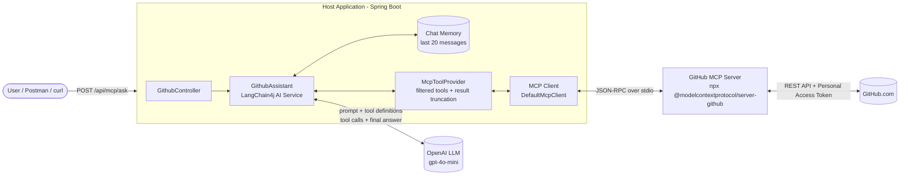
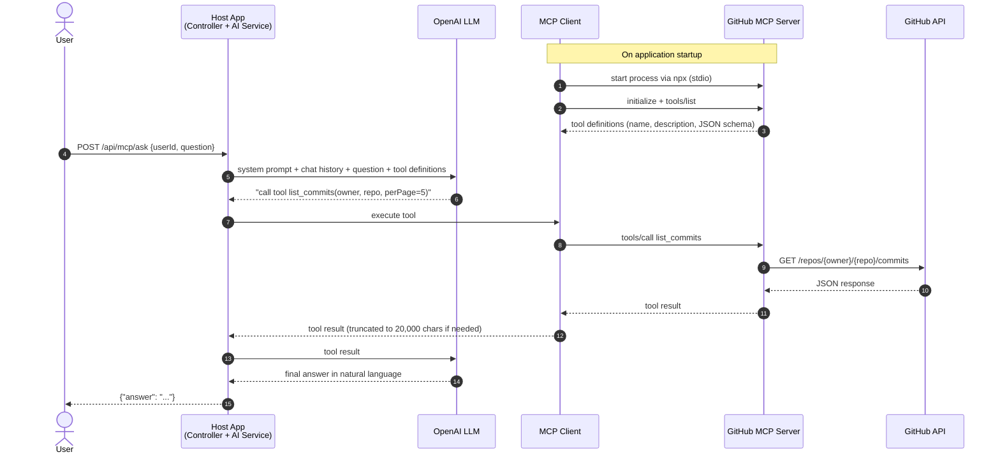

# GitHub MCP Server – AI Assistant with Spring Boot & LangChain4j

A Spring Boot application that lets you **ask questions about GitHub in plain English**, for example:

> "Show me the latest 5 commits in spring-projects/spring-boot"
> "List open issues in my repo and create a new issue for the login bug"

The application does **not** contain any GitHub API code. Instead, it connects to the official
**GitHub MCP Server** and lets an **LLM (OpenAI GPT-4o-mini)** decide which GitHub tools to call.
This is the core idea of **Agentic AI with the Model Context Protocol (MCP)**.

---

## Table of Contents

- [What is MCP?](#what-is-mcp)
- [Architecture](#architecture)
- [The Four Building Blocks](#the-four-building-blocks)
- [Request Flow – Step by Step](#request-flow--step-by-step)
- [Why use the GitHub MCP Server?](#why-use-the-github-mcp-server)
- [Tech Stack](#tech-stack)
- [Project Structure](#project-structure)
- [Getting Started](#getting-started)
- [API Usage](#api-usage)
- [Design Decisions](#design-decisions)
- [Security](#security)

---

## What is MCP?

The **Model Context Protocol (MCP)** is an open standard that defines how AI applications talk to
external tools and data sources. Think of it as **"USB-C for AI"**:

- Any **MCP server** exposes a set of tools (e.g. `list_issues`, `create_issue`) in a standard format.
- Any **MCP client** can discover and call those tools – no matter who wrote the server or which language it uses.
- The **LLM** reads the tool descriptions and decides which tool to call, with which arguments.

So instead of writing a custom integration for every service, you plug in a ready-made MCP server.

---

## Architecture



---

## The Four Building Blocks

| Component | In this project | Responsibility |
|---|---|---|
| **Host Application** | Spring Boot app (`GithubController`, `GithubAssistant`) | Receives the user's question, owns the conversation, connects the LLM with the tools and returns the final answer. |
| **MCP Client** | `DefaultMcpClient` + `StdioMcpTransport` (LangChain4j) – configured in `McpConfig` | Starts the MCP server as a child process, performs the MCP handshake, discovers the available tools and executes tool calls on behalf of the LLM. |
| **MCP Server** | `@modelcontextprotocol/server-github` (Node.js, started via `npx`) | Exposes GitHub operations as MCP tools and translates each tool call into real GitHub REST API calls using your token. |
| **LLM** | OpenAI `gpt-4o-mini` | The "brain". Understands the question, decides **which tool to call with which arguments**, reads the tool result and writes the final answer. |

> **Important:** The LLM never talks to GitHub directly. It only *asks* for a tool call.
> The host application executes that call through the MCP client and sends the result back to the LLM.

---

## Request Flow – Step by Step



1. **Startup** – Spring creates the `McpClient` bean. It launches the GitHub MCP server with `npx`, passes the
   GitHub token as an environment variable and fetches the list of available tools.
2. **User asks a question** – `GithubController` receives the request and calls `GithubAssistant.ask(userId, question)`.
3. **AI Service builds the prompt** – LangChain4j adds the system message, the user's previous messages
   (chat memory, per `userId`) and the descriptions of the allowed tools.
4. **LLM decides** – If the question needs live GitHub data, the LLM responds with a *tool call request*
   instead of a text answer.
5. **Tool execution** – LangChain4j forwards the call to the MCP client, which sends it to the MCP server.
   The server calls the GitHub API and returns the result.
6. **Loop** – The result goes back to the LLM. The LLM may call more tools (e.g. search a repo, then list its issues)
   until it has enough information.
7. **Final answer** – The LLM writes a short answer, which is returned as JSON.

---

## Why use the GitHub MCP Server?

Without MCP, building this assistant would mean writing and maintaining code for every GitHub feature:

| Without MCP | With the GitHub MCP Server |
|---|---|
| Write a REST client for each GitHub endpoint (commits, issues, files, search…) | **Zero GitHub API code** – tools are ready to use |
| Write DTOs, error handling, pagination, auth headers | Handled inside the MCP server |
| Write `@Tool` methods and descriptions for the LLM by hand | Tool names, descriptions and JSON schemas come from the server |
| Update your code when the GitHub API changes | Update the MCP server version |
| Integration only works in *this* app | The same server works with any MCP client (Claude Desktop, IDEs, other agents) |

**How it helps developers:**

- **Faster development** – a working GitHub assistant in ~5 small classes.
- **Focus on business logic** – you decide *which* tools to expose and *how* the assistant behaves; the plumbing is reused.
- **Plug-and-play** – want Slack, Jira or a database too? Add another MCP client for that server; the AI service stays the same.
- **Standard and reusable** – one protocol for all tools, instead of a different SDK for every service.
- **Natural-language access** – team members can query repos, commits and issues without knowing the GitHub API.

### Tools exposed in this project

The GitHub MCP server offers many tools. This project deliberately exposes only five (see `McpConfig`):

| Tool | What it does |
|---|---|
| `search_repositories` | Search GitHub repositories |
| `list_issues` | List issues of a repository |
| `get_file_contents` | Read a file or directory from a repository |
| `list_commits` | List commits of a branch |
| `create_issue` | Create a new issue in a repository |

---

## Tech Stack

- **Java 21**
- **Spring Boot 4.1** (Web MVC)
- **LangChain4j 1.18** – AI Services, MCP client, OpenAI integration (`-spring-boot4-starter` modules)
- **OpenAI** `gpt-4o-mini`
- **GitHub MCP Server** – `@modelcontextprotocol/server-github` (Node.js)
- **Maven**

---

## Project Structure

```
src/main/java/com/org/githubmcpserver
├── GithubMcpServerApplication.java   # Spring Boot entry point
├── assistant
│   └── GithubAssistant.java          # @AiService interface – system prompt + memory id
├── config
│   ├── McpConfig.java                # MCP client (stdio transport) + filtered ToolProvider
│   └── MemoryConfig.java             # Chat memory: last 20 messages per user
└── web
    └── GithubController.java         # REST endpoint POST /api/mcp/ask

src/main/resources
└── application.properties            # App config – secrets come from env vars / secrets.properties
```

---

## Getting Started

### Prerequisites

- Java 21+
- Node.js (includes `npx`) – needed to start the GitHub MCP server
- A **GitHub Personal Access Token** (fine-grained token with only the repository permissions you need)
- An **OpenAI API key**

### 1. Clone the repository

```bash
git clone <your-repo-url>
cd github-mcp-server
```

### 2. Configure your secrets

**Option A – local file (recommended for development)**

```bash
cp secrets.properties.example secrets.properties
```

Then put your own values into `secrets.properties`. This file is listed in `.gitignore` and is never committed.

**Option B – environment variables**

```bash
# Linux / macOS
export GITHUB_TOKEN=your-token
export OPENAI_API_KEY=your-key

# Windows (PowerShell)
$env:GITHUB_TOKEN="your-token"
$env:OPENAI_API_KEY="your-key"
```

### 3. Check the `npx` command

`application.properties` uses `npx.cmd`, which is correct on **Windows**.
On Linux/macOS, change it to:

```properties
org.khan.mcp.npx=npx
```

### 4. Run the application

```bash
./mvnw spring-boot:run        # Linux / macOS
mvnw.cmd spring-boot:run      # Windows
```

The first start can take a little longer because `npx` downloads the GitHub MCP server package.
With `logging.level.dev.langchain4j.mcp=DEBUG` you can see the MCP handshake and every tool call in the console.

---

## API Usage

**Endpoint:** `POST http://localhost:8080/api/mcp/ask`

```bash
curl -X POST http://localhost:8080/api/mcp/ask \
  -H "Content-Type: application/json" \
  -d '{
        "userId": "user-1",
        "question": "What are the latest 5 commits in spring-projects/spring-boot?"
      }'
```

**Response**

```json
{
  "answer": "The latest commits in spring-projects/spring-boot are ..."
}
```

Because of chat memory, a follow-up question with the same `userId` can refer to the previous answer:

```json
{ "userId": "user-1", "question": "Who made the second one?" }
```

---

## Design Decisions

- **Tool filtering** – Only five tools are sent to the LLM. Fewer tools mean a smaller prompt (lower cost),
  better tool selection and less risk of unwanted actions such as deleting or merging.
- **Tool result truncation** – A tool wrapper cuts results longer than 20,000 characters. GitHub responses
  can be very large; this protects the context window and keeps token costs predictable.
- **Chat memory per user** – `MessageWindowChatMemory` keeps the last 20 messages for each `userId`,
  so the assistant can handle follow-up questions.
- **Short, tool-first system prompt** – The assistant is told to use tools instead of guessing,
  to request at most 5 items, and to answer in three short sentences.
- **Temperature 0.0** – Deterministic, factual answers.

---

## Security

- **Never commit secrets.** Tokens and API keys are read from environment variables or the git-ignored
  `secrets.properties` file. Only `secrets.properties.example` (with placeholders) is part of the repository.
- Use a **fine-grained GitHub token** with the minimum permissions required. `create_issue` needs write access
  to issues; all other exposed tools are read-only.
- If a key is ever exposed, **revoke it immediately** in GitHub / OpenAI settings and create a new one.
